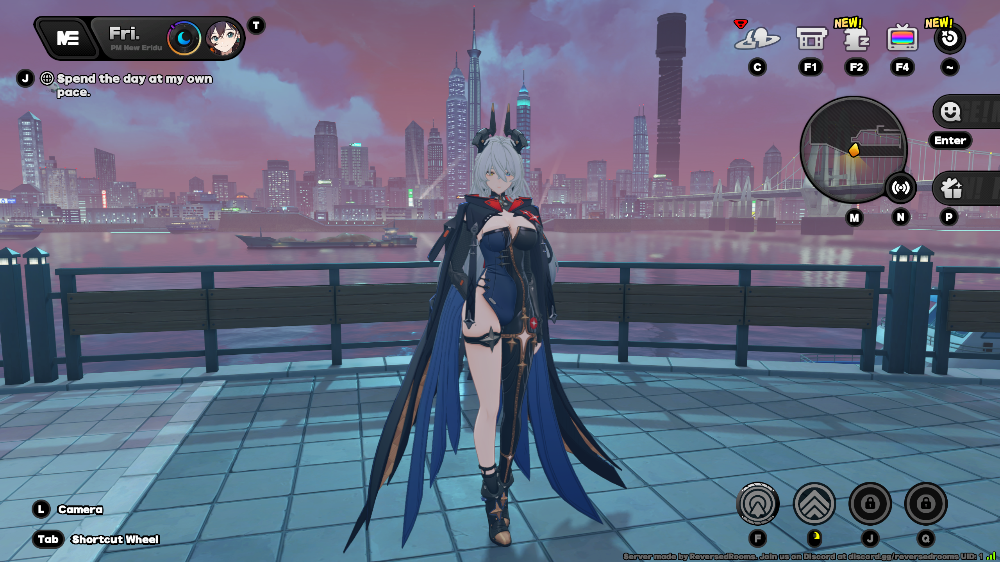

# Eldreda
A free and open-source server emulator for the game Zenless Zone Zero.


## Installation
You can download a pre-built, ready-to-use executable from the [releases page](https://git.xeondev.com/eldreda/eldreda/releases).

## Building from Source
Ensure you have Zig compiler of version `0.17.0`. You can download it from the official website: [Linux](https://ziglang.org/download/0.17.0/zig-x86_64-linux-0.17.0.tar.xz)/[Windows](https://ziglang.org/download/0.17.0/zig-x86_64-windows-0.17.0.zip), or by using a [version manager](https://git.xeondev.com/nyan/zvm/releases).

First, double-check the compiler version
```sh
$ zig version
0.17.0
```

If the output matches, simply run
```sh
zig build
```

If the compilation succeeds, the server executable should appear in the `zig-out/bin` directory.

## Configuration
To start the server, simply run the `eldreda` executable.

To see the available command-line options, run `eldreda --help`.

Some options can be customized through a configuration file. Default settings are declared in [defaults/eldreda.zon](defaults/eldreda.zon).

Before trying to connect to server, make sure you have the compatible client version (`OSPRODWin3.3.0` at the time of writing) and [eldreda-patch](https://git.xeondev.com/eldreda/eldreda-patch) installed.

## Features
Eldreda is in early state of development and has the following features available:
- Logging in
- Training room

For the implementation roadmap, see [the issue tracker](https://git.xeondev.com/eldreda/eldreda/issues).

## Contributing
[Donate](https://boosty.to/xeondev/donate).

[Join project-specific discord server](https://eldreda.xeondev.com).

[Join ReversedRooms discord server](https://discord.xeondev.com).

[Join ReversedRooms telegram channel](https://t.me/reversedrooms).
